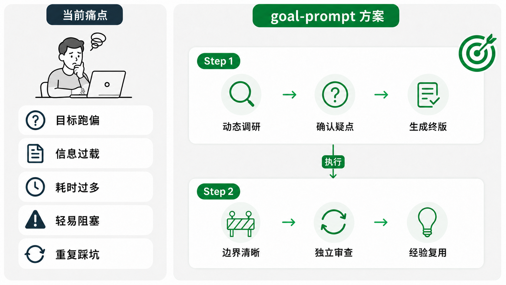
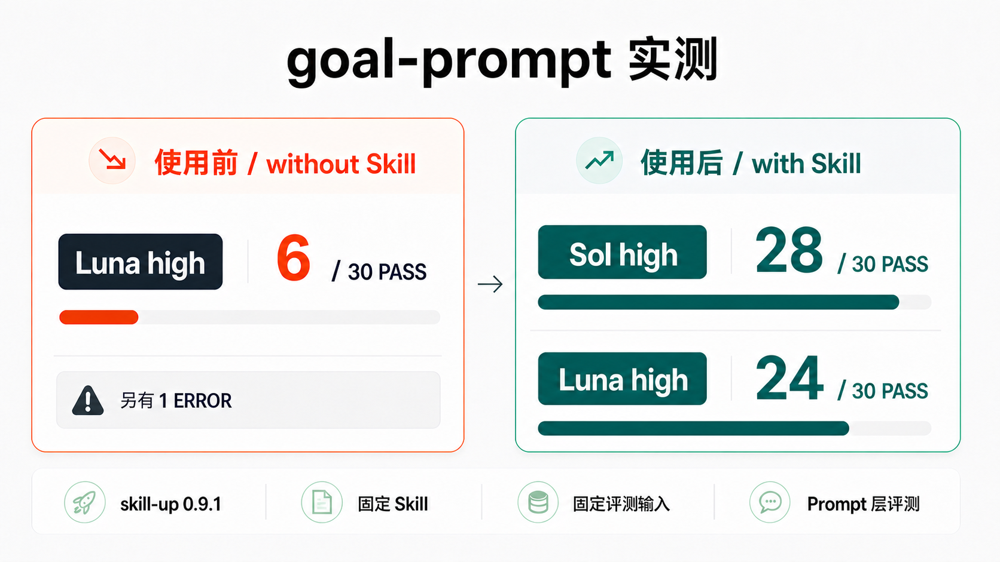
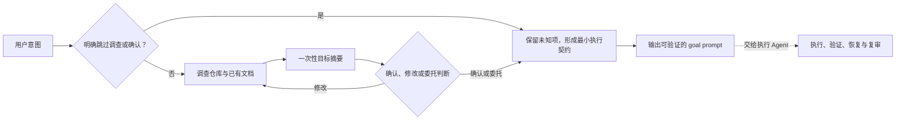

# goal-prompt [](../README.md)

[](../CHANGELOG.md)
[](https://github.com/imbajin/goal-prompt/actions/workflows/validate.yml)
[](../LICENSE)
[](https://agentskills.io/)

`goal-prompt` 将任务整理成边界清楚、可验证的 `/goal`。它先了解仓库、澄清关键问题，再经确认生成目标；你也可以明确跳过调查、跳过确认或委托判断。Skill 只生成 prompt，执行由后续 Agent 承担。



## 1.3 更新

- 精简主 Skill，明确授权、循环反馈与里程碑审查等关键契约。
- 提供可复用的 skill-up 0.14 评测工具和 capacity 退避测试 fixture；不提供或启用 Desktop 自动恢复。

详见[更新说明](../CHANGELOG.md)。

## 为什么用它？

自己写 `/goal` 时，最难拿捏的是尺度：
- 写短了，Agent 很快就做完 or 做到一半就提前标记完成
- 写长了，或引入复杂 spec（需求/设计/TODOs 和规则全挤在一起），非常耗时 + 执行时约束过多

| 常见做法 | 实际问题 | goal-prompt 的处理 |
| --- | --- | --- |
| 直接手写 `/goal` | 篇幅难，范围和完成条件容易漏 | 保持精炼，优先保留结果、范围、完成门槛和必要执行语义 |
| 只参考 Codex/CC 官方说明 | 官方文档解释了命令和基础规则，但不会结合具体仓库判断范围、风险和验证方式 | 先调查真实上下文，再决定目标里该留什么 |
| 使用较早的开源方案 | 有的没有跟上 `/goal` 的变化；有的依赖多 SPEC 文档，准备时间很长 | 默认不创建额外文件，复杂任务也从一份最小状态开始 |
| 一次生成后直接执行 | 错误假设会原样进入长任务 | 先规划、提问和确认，再生成最终 `/goal` |
| 小失败，提前终止 | CI 等待、权限缺口或单项失败就让整体 `blocked` | 只要还有独立工作就继续，只有全部剩余工作共同受阻才停止 |
| 只依赖历史 context  | 踩坑/经验没有沉淀，下一轮重复试错 | 在深度 state 中连接结果评价与下一步；仅在值得复用时记录经验 |
| 写法绑定单一 Agent | 换到其他 Agent 后，调用方式/目录或指令对不上 | 指令/保持通用，只对平台入口做少量适配 |

## 快速开始

最简安装，运行后选择目标 Agent：

```bash
npx skills add imbajin/goal-prompt
```

（可选）全局安装到 Codex + Claude Code：

```bash
npx skills add imbajin/goal-prompt -g -a codex -a claude-code
```

已安装旧版本时，在原安装范围更新：

```bash
npx skills update goal-prompt
```

如果原来使用 `-g` 全局安装，运行 `npx skills update goal-prompt -g -y`

（可选）把下面的 prompt 发给任意 Agent：

```text
请按照 https://github.com/imbajin/goal-prompt#quick-start 安装 goal-prompt
```

直接使用：

```text
# Codex / Claude Code
/goal-prompt 帮我给当前目录的认证模块定一个任务计划, 参考 XX 设计实现
```

需求沟通时，Agent 可自动调用这个 skill，你也可以用 `/goal-prompt` 手动调用。无论哪种方式，它只生成 prompt，不会直接执行

## 实测结果

当前开发评测使用 skill-up 0.14.0，共 31 个用例。结果按模型、冻结 Skill 和判分协议分别记录。

| 模型 | 验证依据 |
| --- | --- |
| GPT-6.1 Sol / high | [with-Skill 定向实测](../evals/skill-up/gpt61-refresh.md)跨快照覆盖 17 个唯一案例；判分误报使用原输出重判，不是最终版本的一次 17/17 全通过。 |
| GPT-6 Luna / xhigh | [隔离对照与小规模版本比较](luna-xhigh-trial.md)保留原始失败和局部重判。选定案例的循环反馈契约保留改善，后续执行仍未验证。 |

迁移语义 Judge 仍标为 `uncalibrated`，CI 只检查评分路由及回执一致性，不证明语义判分正确。完整 6.1 与干净的 without-Skill 全量仍待补；Claude Code 已检查安装，1.3 跳过实机行为测试。详见[评测说明](../evals/skill-up/README.md)和[恢复边界](goal-recovery.md)。

**历史 5.6 结果**使用 skill-up 0.9.1：同一 Luna high 模型，without Skill 为 6/30，with Skill 为 24/30，基线另有一次超时 ERROR；Sol high with Skill 为 28/30。这些冻结成绩包含旧判分器，不代表当前 1.3 的完整复测。



## 核心设计

`goal-prompt` 目标是高效率 + 尽可能提高质量的前提下，保留执行期间必须有的信息

- 事实优先：先读仓库和已有文档，不用猜测补齐空白
- 用户控制：用户可以确认、修改、委托判断，也可以明确跳过调查或确认
- 状态最小：默认不建文件；需要恢复时才创建职责清楚的状态文件
- 证据闭环：范围内的完成门槛必须全部通过，测试成功不能代替其他交付证据
- 阻塞从严：只要还有独立工作就继续，只有全部剩余工作共同受阻时才停止



## 工作方式

### 两阶段流程

```text
+--------------------------- Step 1: goal-prompt ----------------------------+
|  真实任务 -> 调查上下文 -> 关键问题 -> 确认或委托 -> 生成最终 prompt
+----------------------------------------------------------------------------+

                              ⬇️  执行 /goal

+---------------------------- Step 2: 执行 Agent ----------------------------+
|  执行迭代 -> review + 小结 -> 归纳经验（可选）
+----------------------------------------------------------------------------+
```

**第一阶段**只返回临时目标摘要，包括预期结果、范围、排除项和完成证据。会改变目标的假设没有确认前，不会生成 `/goal`

用户确认、委托判断或明确跳过确认后，进入**第二阶段**。最终 prompt 只保留执行需要的内容：

- 预期结果、范围和排除项；
- 必须全部满足的完成条件和验证证据；
- 遇到 CI、测试或外部依赖阻塞时如何调整顺序；
- 全部剩余工作确实无法继续时，允许停止的条件；
- 行为变更代码所需的独立审查

普通任务默认不创建额外文件。深度任务或跨会话任务使用 `.goal-task/<task-slug>/state.md` 记录当前执行状态。已有 requirement、design、SPEC 和 TODO 继续作为权威事实，通过链接复用，不复制内容

只有职责明确且不会重复时，才增加其他文件：

- `state.md`：记录当前阶段、证据、阻塞、事实入口和下一步；
- `todo.md`：维护大量或频繁变化的事项级任务；
- `design.md`：没有更权威设计文档时，保存已经确认的设计决定；
- `lessons.md`：保存有证据且值得复用的经验

如果新增文件会重复 `state.md` 或已有文档，就不要创建

## 兼容说明

核心内容位于 `skills/goal-prompt/`，使用通用的 [Agent Skills](https://agentskills.io/) 目录结构。Codex 通过 `skills/goal-prompt/agents/openai.yaml` 提供入口信息，Claude Code 使用标准 skill frontmatter；两者都允许自动选择和手动调用

Codex 可以把生成的文本交给原生 `/goal` 持续执行。Claude Code 可以调用 `/goal-prompt` 并生成同样的结构化目标文本，但没有 Codex 原生 `/goal` 的运行语义，需要通过 Claude Code 的普通执行流程继续任务。其他支持 Agent Skills 的 Agent 也可以复用

## 参考资料

为了避免闭门造车 or 重复造轮，先广搜并实测了 4 个 goal-skills，并参考了下面引用的部分思路和设计。对比评测的方法、结果和复现方式统一收录在 [skill-up 评测说明](../evals/skill-up/README.md)
- OpenAI 官方 [`define-goal`](https://github.com/openai/skills/blob/main/skills/.curated/define-goal/SKILL.md) skill
- [`goal-prompt-builder`](https://github.com/win4r/goal-prompt-builder) skill
- [`goal-forge`](https://github.com/michaelpersonal/goal-forge) skill
- [`leader`](https://github.com/KKKKhazix/khazix-skills/blob/main/leader/SKILL.md) skill

>设计细节见 [`fusion-notes.md`](fusion-notes.md)，版本历史见 [CHANGELOG.md](../CHANGELOG.md)

## 许可证

Apache License 2.0，详见 [`LICENSE`](../LICENSE)
